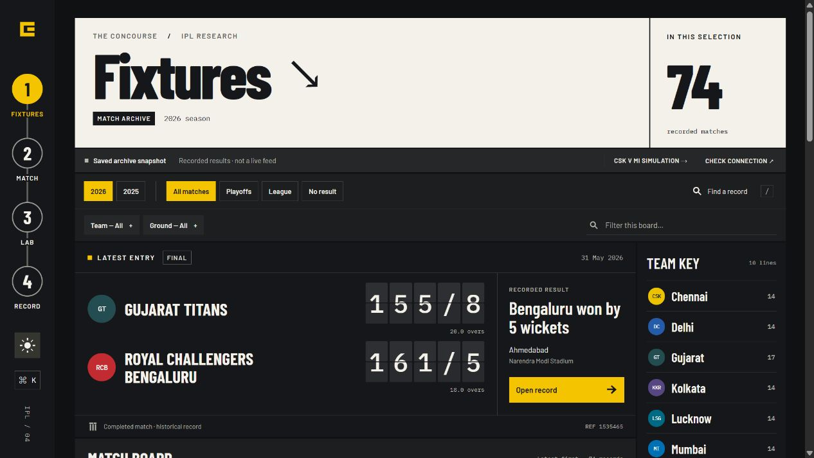

# Bayesian IPL roster optimizer

**The Concourse** is an IPL archive, experimental match simulator and franchise XI planning interface. React/TypeScript/Vite powers the frontend; FastAPI, Bayesian delivery models and constrained optimization power the local backend. Both light and dark themes are complete.

For a frontend-only checkout, run `npm ci` then `npm run dev` inside `frontend/`. Saved examples work without the local data pack. New simulations need the Python service and its restored data. [Completed frontend guide](docs/frontend-release.md) · [Vercel setup](docs/vercel.md).

The data foundation is collected under [`outputs/ipl-data`](outputs/ipl-data/README.md), and the read-only FastAPI backend is implemented in `backend/`. Version 0.5 adds reproducible full-match backtesting, prior-only historical strategies and exposure-weighted reliability audits. See the [full-match evaluation guide](docs/full-match-backtesting.md), [reliability report](docs/reliability.md), [match-planning guide](docs/match-planning.md), [backend guide](docs/backend.md) and [Bayesian model card](docs/bayesian-model.md) for measured results and limitations.

The [completed full-match results](docs/full-match-results.md) do **not** establish useful winner-prediction skill or reliable XI benefits. Score-uncertainty challengers are promising but remain diagnostic-only; do not present this project as a validated prediction service.

The subsequent [direct winner-model study](docs/winner-research.md) tested sixty selection recipes and evaluated the locked choice on all seventy eligible 2026 games. It reached **55.7%, not the requested 70%**, and did not beat the always-chase baseline. The JSON model and research CLI are available for reproducible analysis; they are not promoted into live planning defaults.

The [2025 match-day evidence pilot](docs/prematch-pipeline.md) adds broader men's T20 form, dated availability claims and timestamped XI/substitute reports in a separate research database. Source inspection now covers 144 of 150 starting-XI team slots and 144 of 150 substitute-list slots, including all 68 games in the predefined training population. Its nomination-source research gate passes under the documented publisher-timestamp assumptions. Three inventory fixtures remain incomplete; availability coverage is still limited. This data work has not changed the measured prediction accuracy.

The current delivery includes raw attributable sources, analysis-ready tables, an indexed SQLite database, the official 2026 playing-conditions PDF and reproducible checks. The API serves observations, recent form and Bayesian delivery forecasts, plus two computation endpoints: `POST /api/v1/simulations/match` and `POST /api/v1/optimization/xi`. Simulation covers uninterrupted two-innings matches and bounded Super Overs. The optimizer generates constrained surrogate-optimal XIs and compares them by simulation; globally optimal win probability is not proven. Full-match accuracy is not historically calibrated. All five Concourse frontend phases are complete: real-data Fixtures, experimental Match simulation, Lab team-plan/XI optimization, Record evidence, and integration/polish in light and dark modes. Match eligibility, live availability, measured pitch/weather and full supplementary Impact-rule verification remain outstanding; limited explicit domestic interval Impact scenarios are supported. Database contents are never mutated by these endpoints.

Start the frontend with `.\scripts\start_frontend.ps1`, then open [The Concourse](http://127.0.0.1:5173). It uses labelled saved archive snapshots while the API is unavailable. See the [completed frontend guide](docs/frontend-release.md), [frontend setup](frontend/README.md) and [phased delivery record](docs/frontend-phases.md), plus the [Match](docs/frontend-match.md), [Lab](docs/frontend-lab.md) and [Record](docs/frontend-record.md) guides. Final checks include 86 passing frontend tests, a production build, both themes, 320–1920px layouts and connected/offline browser flows. The frontend work changes no measured prediction accuracy.

Start the prepared local backend with `.\scripts\start_backend.ps1`, then open [API documentation](http://127.0.0.1:8000/docs). Fresh setup, configuration, all endpoints, metric definitions and test commands are in the [backend guide](docs/backend.md). Runtime requirements are pinned in `requirements-backend.txt`; development/test requirements are in `requirements-dev.txt`.

`scripts/` contains the pipeline; `config/` contains reviewed identity/venue mappings and sourced attribute supplements. Install `requirements-data.txt`, then follow the data pack's rebuild instructions. Do not commit or publish the raw third-party dataset pack until redistribution rights have been reviewed.
